# planIT Database Schema

ฐานข้อมูล PostgreSQL ของ planIT มี 20 ตาราง แบ่งเป็น 4 ส่วน: หลักสูตร, Track, ผู้ใช้/แผนการเรียน/รีวิว และ mock ระบบทะเบียน ข้อมูลหลักสูตรอิงหลักสูตร วท.บ. IT 2567 (128 หน่วยกิต)

Backend ใช้ `spring.jpa.hibernate.ddl-auto=validate` — คอลัมน์ที่ entity map ต้องมีใน DB ไม่งั้น start ไม่ขึ้น (คอลัมน์ที่ DB มีเกินไม่เป็นไร) แก้ schema แล้วต้องแก้ entity ใน PR ฝั่ง backend คู่กัน

## ภาพรวมความสัมพันธ์

ทุกส่วนเชื่อมกันผ่าน `courses` กับ `curriculum_versions` ส่วน mock ทะเบียนจับคู่กับ `users` ด้วย `student_id` โดยไม่มี FK

```mermaid
erDiagram
    curriculum_versions ||--o{ curriculum_categories : has
    categories ||--o{ curriculum_categories : names
    curriculum_categories ||--o{ curriculum_category_courses : contains
    courses ||--o{ curriculum_category_courses : "in category"
    courses ||--o{ course_prerequisites : "requires"
    courses ||--o{ course_prerequisites : "is prerequisite"

    track_groups ||--o{ tracks : groups
    curriculum_versions ||--o{ tracks : has
    tracks ||--o{ track_courses : contains
    courses ||--o{ track_courses : "in track"
    tracks ||--o{ related_tracks : "related from"
    tracks ||--o{ related_tracks : "related to"

    users ||--o{ study_plans : owns
    curriculum_versions ||--o{ study_plans : follows
    tracks |o--o{ study_plans : "chosen track"
    study_plans ||--o{ study_plan_courses : contains
    courses ||--o{ study_plan_courses : planned
    users ||--o{ reviews : writes
    courses ||--o{ reviews : "reviewed"
    courses ||--o{ course_tags : tagged
    tags ||--o{ course_tags : tags

    curriculum_versions ||--o{ registrar_students : enrolled
    registrar_students ||--o{ registrar_enrollments : registers
    courses ||--o{ registrar_enrollments : registered
    registrar_enrollments ||--o| student_course_grades : graded
    users ||--o{ student_course_grades : enters

    curriculum_versions {
        int curriculum_version_id PK
        int academic_year UK
        int total_credits
    }
    categories {
        int category_id PK
        varchar code UK
    }
    curriculum_categories {
        int curriculum_category_id PK
        int curriculum_version_id FK
        int category_id FK
        int required_credits
        int sort_order
    }
    courses {
        int course_id PK
        varchar course_code UK
        int credits
        text prerequisite_note
    }
    curriculum_category_courses {
        int curriculum_category_id PK, FK
        int course_id PK, FK
        bool is_required
        int standard_year
        int standard_semester
    }
    course_prerequisites {
        int course_prerequisite_id PK
        int course_id FK
        int prerequisite_course_id FK
        int group_no
        bool is_corequisite
    }
    track_groups {
        int track_group_id PK
        int sort_order
    }
    tracks {
        int track_id PK
        int curriculum_version_id FK
        int track_group_id FK
        varchar track_name_en
        int required_credits
    }
    track_courses {
        int track_id PK, FK
        int course_id PK, FK
        bool is_required
        int choice_group
        int standard_year
        int standard_semester
    }
    related_tracks {
        int track_id PK, FK
        int related_track_id PK, FK
        int sort_order
    }
    users {
        int user_id PK
        varchar student_id UK
        varchar email UK
        user_role role
    }
    study_plans {
        int study_plan_id PK
        int user_id FK
        int curriculum_version_id FK
        int track_id FK
    }
    study_plan_courses {
        int study_plan_course_id PK
        int study_plan_id FK
        int course_id FK
        int study_year
        int study_semester
    }
    reviews {
        int review_id PK
        int user_id FK
        int course_id FK
        int overall_rating
    }
    registrar_students {
        varchar student_id PK
        int curriculum_version_id FK
        int admission_year
    }
    registrar_enrollments {
        int enrollment_id PK
        varchar student_id FK
        int course_id FK
        int academic_year
        int semester
        varchar status
    }
    student_course_grades {
        int grade_id PK
        int user_id FK
        int enrollment_id FK, UK
        varchar grade
    }
```



`users_invitations` ไม่มีความสัมพันธ์กับตารางอื่น จึงไม่อยู่ในแผนภาพ

## หลักสูตรและรายวิชา

หลักสูตรหนึ่งฉบับแบ่งเป็น 5 หมวดแบบแบน ตามโครงสร้างหน่วยกิตของเล่มหลักสูตร วิชาหนึ่งตัวอยู่ได้ 1 หมวดต่อหลักสูตร

| ตาราง | เก็บอะไร | คอลัมน์สำคัญ |
| --- | --- | --- |
| `curriculum_versions` | ฉบับหลักสูตร (ตอนนี้มี 2567 ฉบับเดียว) | `academic_year` (unique), `total_credits` = 128 |
| `categories` | ชื่อหมวดวิชา ไม่ผูกหลักสูตร | `code`, `category_name_th/en` |
| `curriculum_categories` | หมวดในหลักสูตรหนึ่งฉบับ + หน่วยกิตที่ต้องเรียน | `required_credits`, `sort_order`, `parent_curriculum_category_id` (ตอนนี้เป็น NULL ทั้งหมด) |
| `courses` | รายวิชา 213 วิชา (หลักสูตร 151 + เลือกเสรี 62) | `course_code` (unique), `name_th/en`, `credits`, `description_th/en`, `prerequisite_note`, `is_active` |
| `curriculum_category_courses` | วิชาไหนอยู่หมวดไหน + ปี/เทอมมาตรฐาน | PK (`curriculum_category_id`, `course_id`), `is_required`, `standard_year`, `standard_semester` |
| `course_prerequisites` | วิชาบังคับก่อน 68 แถว | `course_id`, `prerequisite_course_id`, `group_no`, `is_corequisite` |

หมวดทั้ง 5 ของหลักสูตร 2567:

| sort | code | ชื่อ | หน่วยกิต | วิชาบังคับ |
| --- | --- | --- | --- | --- |
| 1 | `GE` | หมวดวิชาศึกษาทั่วไป | 27 | ทั้งหมด 11 วิชา (GEN 5 + LNG 6) |
| 2 | `MAJOR_FOUNDATION` | วิชาพื้นฐานทางเทคโนโลยีสารสนเทศ | 60 | ทั้งหมด 33 วิชา |
| 3 | `MAJOR_ADVANCED` | วิชาเชิงลึกทางเทคโนโลยีสารสนเทศ | 21 | ไม่มีกลาง — บังคับตาม track (`track_courses`) ที่เหลือเลือกเอง |
| 4 | `PROJECT` | การเรียนรู้ผ่านการทำโครงงานหรือประสบการณ์การทำงาน | 14 | INT504, INT509 (8) + เลือก Capstone INT505/506 หรือ Research INT507/508 (6) |
| 5 | `FREE_ELECTIVE` | หมวดวิชาเลือกเสรี | 6 | ไม่มี — วิชาใดก็ได้ใน มจธ. (62 วิชาในหมวดเป็นแค่ pool แนะนำ) |

**วิชาบังคับก่อน** — อ่านแบบนี้:

- `group_no` เดียวกัน = ผ่านอย่างใดอย่างหนึ่ง (OR) เช่น INT506 ต้องผ่าน INT505 หรือ INT507
- ต่าง `group_no` = ต้องผ่านทุกกลุ่ม (AND) เช่น INT151 ต้องผ่าน INT141 และ INT150
- `is_corequisite = true` = ผ่านมาแล้วหรือเรียนพร้อมกันได้ (INT282, INT504, INT506, INT508)
- เงื่อนไขที่ไม่ใช่รายวิชาในระบบ (ผ่าน 60 หน่วยกิต, ขึ้นกับอาจารย์, วิชาของหลักสูตร CS/DSI) เก็บเป็นข้อความใน `courses.prerequisite_note` (52 วิชา)

## Track

Track คือ "แผนการเรียน" 9 แผนของหลักสูตร แต่ละแผนกำหนดวิชาบังคับเลือกในหมวด 2.2 พร้อมปี/เทอม (ปี 2 เทอม 2 ถึงปี 3 เทอม 2) หน่วยกิตที่เหลือจาก 21 เป็นวิชาเลือกหมวด 2.2

| ตาราง | เก็บอะไร | คอลัมน์สำคัญ |
| --- | --- | --- |
| `track_groups` | กลุ่มบนหน้า Track list (ทีมกำหนดเอง หลักสูตรไม่ได้จัดกลุ่มไว้) | `group_name_th/en`, `sort_order` |
| `tracks` | 9 track | `track_group_id`, `track_name_th/en` (unique ต่อหลักสูตร), `description_th/en`, `required_credits`, `sort_order` |
| `track_courses` | วิชาของ track + ปี/เทอม 55 แถว | PK (`track_id`, `course_id`), `is_required`, `choice_group`, `standard_year`, `standard_semester` |
| `related_tracks` | track ใกล้เคียง (ทางเดียว) 18 แถว | PK (`track_id`, `related_track_id`), `sort_order` |

| กลุ่ม | Track | หน่วยกิตบังคับ | Track ใกล้เคียง |
| --- | --- | --- | --- |
| สายพัฒนาซอฟต์แวร์ | Frontend Developer | 12 | Full-Stack, UX/UI, Backend |
| สายพัฒนาซอฟต์แวร์ | Backend Developer | 12 | Full-Stack, Frontend |
| สายพัฒนาซอฟต์แวร์ | Full-Stack Developer | 18 | Frontend, Backend |
| สายข้อมูลและ AI | AI Developer | 18 (15 + เลือก 1 จาก INT370/371/47x) | Data Scientist, Data Analyst |
| สายข้อมูลและ AI | Data Scientist | 16 | Data Analyst, AI, Data Engineer |
| สายข้อมูลและ AI | Data Analyst | 14 | Data Scientist, AI |
| สายข้อมูลและ AI | Data Engineer | 11 | Database Administrator, Data Scientist |
| สายข้อมูลและ AI | Database Administrator | 7 | Data Engineer |
| สายออกแบบ | UX/UI Designer | 9 | Frontend |

- กลุ่มกับ track ใกล้เคียงจัดตามวิชาบังคับเลือกที่ใช้ร่วมกันในตารางแผนการศึกษาของเล่มหลักสูตร (เช่น `FE, FS INT251`) + ตัวอย่างในเล่ม "สาย Frontend Developer คู่กับสาย UX/UI Designer" — วิชาที่ใช้ร่วมกัน: FE–FS 4, BE–FS 4, AI–DS 4, AI–DA 4, DS–DA 6, DE–DB 6, DS–DE 1 (INT297)
- `choice_group`: วิชาที่มีเลขเดียวกันใน track เดียวกัน = เลือกเรียน 1 วิชา (ตอนนี้มีแค่ AI ปี 3/2)
- คำอธิบาย track ทีมเขียนเอง เล่มหลักสูตรมีแค่ชื่ออาชีพ

## ผู้ใช้ แผนการเรียน และรีวิว

แถวใน `users` ถูกสร้างตอน login ครั้งแรก (`POST /v1/auth/sync`) backend ดึง `student_id` จากอีเมล `{รหัส}@ad.sit.kmutt.ac.th` ส่วน staff/admin ไม่มี `student_id`

| ตาราง | เก็บอะไร | คอลัมน์สำคัญ |
| --- | --- | --- |
| `users` | ผู้ใช้ทุก role | `student_id` (unique, NULL สำหรับ staff/admin), `email` (unique), `first_name`, `last_name`, `display_name`, `role` |
| `users_invitations` | อีเมลที่ Admin เชิญล่วงหน้าพร้อม role | `email` (unique), `role` (default `staff`) |
| `study_plans` | แผนการเรียนของนักศึกษา 1 คนมีได้หลายแผน (BE จำกัดไม่เกิน 5) | `user_id`, `curriculum_version_id`, `track_id` (NULL = ยังไม่เลือก track), `plan_name`, `is_default` (แผนหลัก ได้แผนเดียวต่อ user — unique index) |
| `study_plan_courses` | วิชาที่นักศึกษาเพิ่มเองใน plan | PK `study_plan_course_id`, unique (`study_plan_id`, `course_id`, `study_year`, `study_semester`), `study_year` (1–4+), `study_semester` (1–2) |
| `reviews` | รีวิวรายวิชา 1 คนต่อ 1 วิชา แก้/ลบไม่ได้ | unique (`user_id`, `course_id`), `overall_rating`, `difficulty_rating`, `workload_rating`, `comment`, `status` |
| `saved_courses` | วิชาที่นักศึกษาบันทึกไว้ (favorite) | unique (`user_id`, `course_id`), `created_at` |
| `tags`, `course_tags` | tag ของรายวิชา (ยังไม่มีข้อมูล) | `tag_name` (unique) |

| enum | ค่า |
| --- | --- |
| `user_role` | `student`, `staff`, `admin` |
| `review_status` | `visible`, `hidden` |

- วิชาเดียวกันวางแผนได้หลายเทอม (ติด F แล้ววางแผนลงซ้ำ) แต่ไม่ซ้ำในเทอมเดียวกัน plan ไม่เก็บสถานะ: ลงจริงหรือไม่ดูจาก `registrar_enrollments` ผลการเรียนดูจาก `student_course_grades`
- หลายแผน: ข้อมูลทะเบียนไม่ได้บันทึกลงแผน แต่รวมตอนเปิดดู ทุกแผนจึงเห็นเทอมที่ผ่านไปแล้วเหมือนกัน ต่างกันแค่ track กับวิชาที่วางแผนในอนาคต
- แผนหลัก = แผนที่ตั้งใจเดินตาม เปิดก่อนทุกครั้ง และเป็นค่าเริ่มต้นของปุ่ม "เพิ่มลงแผน" เปลี่ยนแผนหลักได้เสมอ (ไม่มีข้อมูลต้องย้าย)
- สร้างแผนใหม่เป็นแผนเปล่าเสมอ (ไม่คัดลอกจากแผนอื่น) แผนแรกของ user ระบบสร้างให้ชื่อ "แผนที่ 1" และเป็นแผนหลักอัตโนมัติ
- plan เก็บเฉพาะวิชาที่นักศึกษาเพิ่มเอง วิชาบังคับ planner ดึงจาก `curriculum_category_courses` กับ `track_courses` อัตโนมัติ
- `study_year`/`study_semester` เป็นชั้นปีของนักศึกษา ไม่ใช่ปีการศึกษา (ต่างจาก mock ทะเบียน)
- ปีที่เกิน 4 ไม่เก็บใน DB: frontend แสดงตารางเปล่า max(`study_year`)+1 จนกว่าจะเพิ่มวิชา

## Mock ระบบทะเบียนและเกรด

ระบบไม่ได้เชื่อมทะเบียนจริง 3 ตารางนี้จำลองข้อมูลว่านักศึกษาลงวิชาอะไรจริง ใช้ทำ planner แบบ plan-vs-actual และเช็คสิทธิ์รีวิว

| ตาราง | เก็บอะไร | คอลัมน์สำคัญ |
| --- | --- | --- |
| `registrar_students` | ข้อมูลนักศึกษาจากทะเบียน | PK `student_id`, `first_name_th`, `last_name_th`, `admission_year`, `curriculum_version_id`, `current_year`, `current_semester` |
| `registrar_enrollments` | วิชาที่ลงทะเบียนจริง | `student_id`, `course_id`, `academic_year` (เช่น 2568), `semester` (1, 2), `status` (`registered` / `withdrawn`), unique (รหัส, วิชา, ปี, เทอม) |
| `student_course_grades` | เกรดที่นักศึกษากรอกเอง | `user_id`, `enrollment_id` (unique), `grade` (A, B+, B, C+, C, D+, D, F, S, U) |

- `registrar_students` ไม่ผูก FK กับ `users` — จับคู่ด้วย `users.student_id` เพราะ users เกิดตอน login
- ทะเบียนเก็บปีการศึกษาจริง แปลงเป็นชั้นปีของ planner ด้วย `study_year = academic_year - admission_year + 1`
- เกรดผูกกับ `enrollment_id` เลยกรอกได้เฉพาะวิชาที่ลงจริง แยกจากตารางทะเบียนเพราะเป็นข้อมูลที่ user สร้างเอง
- ลงซ้ำวิชาเดิมคนละเทอม = คนละแถว (เช่น F แล้วลงใหม่)

## Mock data และเคสทดสอบ

สมมติว่าตอนนี้คือปีการศึกษา 2569 เทอม 1 นักศึกษา mock ทุกคนอยู่หลักสูตร 2567 เทอมปัจจุบันลงทะเบียนแล้วแต่ยังไม่มีเกรด

| รหัส | ชั้นปี | Track | เคสที่ทดสอบ |
| --- | --- | --- | --- |
| 69130500001 | ปี 1 เทอม 1 | — | ยังไม่มี plan: backend ต้องสร้างให้ตอนเปิด planner ครั้งแรก |
| 68130500002 | ปี 2 เทอม 1 | — | plan ที่ `track_id` = NULL, ยังไม่กรอกเกรด |
| 67130500003 | ปี 3 เทอม 1 | Full-Stack | เรียนตามแผนปกติ |
| 67130500004 | ปี 3 เทอม 1 | AI (แผนหลัก) + Data Scientist | F INT133 (2567/2) ลงซ้ำ 2568/1, W INT185 (2568/2) ลงใหม่ 2569/1, มี 2 แผน: แผนหลัก AI + แผน "ลองสาย Data Scientist" |
| 67130500005 | ปี 3 เทอม 1 | Data Engineer | GEN341 วางแผนไว้ปี 2/1 แต่ไม่ได้ลงจริง |

- users mock: นักศึกษา 5 คน + `staff.mock@ad.sit.kmutt.ac.th` + `admin.mock@ad.sit.kmutt.ac.th` (login จริงไม่ได้ ไม่มี Microsoft account)
- invitations: `staff.mock` กับ `staff.pending` (เชิญแล้วยังไม่ login)
- enrolment สร้างจากวิชาบังคับตามแผนมาตรฐาน + วิชาบังคับของ track + วิชาเลือกบางตัว เช็คแล้วไม่ขัด prerequisite (ยกเว้น LNG220 ที่ถือว่าได้ยกเว้น LNG120 จาก O-NET)

ที่มาข้อมูล: วิชาบังคับก่อนและแผนการศึกษาจาก [เล่มหลักสูตร IT 2567 ฉบับย่อ](https://www.sit.kmutt.ac.th/wp-content/uploads/2025/07/%E0%B8%A3%E0%B8%B2%E0%B8%A2%E0%B8%A5%E0%B8%B0%E0%B9%80%E0%B8%AD%E0%B8%B5%E0%B8%A2%E0%B8%94%E0%B8%89%E0%B8%9A%E0%B8%B1%E0%B8%9A%E0%B8%A2%E0%B9%88%E0%B8%AD-BSC-IT-2567.pdf), วิชาเลือกเสรีจาก [สำนักงานทะเบียน มจธ.](https://regis.kmutt.ac.th/service/meangpa/164/art164.pdf) และ [GenEd KMUTT](https://gened.kmutt.ac.th/allcourse/) — ชื่อไทยวิชา LNG/SSC แปลเอง ยังไม่ได้เทียบเอกสารจริง

## แอปใช้ข้อมูลยังไง

สถานะใน planner คำนวณตอน query ไม่เก็บซ้ำ เพื่อให้มีแหล่งความจริงเดียว

| หน้า / ฟีเจอร์ | ดึงจาก |
| --- | --- |
| Track list | `tracks` JOIN `track_groups` เรียง `track_groups.sort_order`, `tracks.sort_order` |
| Track detail: วิชาตามเทอม | `track_courses` จัดกลุ่มตาม (`standard_year`, `standard_semester`), คะแนนจาก AVG(`reviews.overall_rating`) |
| Track detail: โครงสร้างหลักสูตร | `curriculum_categories` เรียง `sort_order` (5 แถว รวม 128) |
| Track detail: track ใกล้เคียง | `related_tracks` เรียง `sort_order` |
| Planner: วิชาบังคับที่ใส่ให้อัตโนมัติ | `curriculum_category_courses` WHERE `is_required` + `track_courses` ของ `study_plans.track_id` WHERE `is_required` |
| Planner: วิชาที่เพิ่มเอง | `study_plan_courses` |
| Planner: เทอมที่ผ่านไปแล้ว | `registrar_enrollments` (ลงจริง) เทียบกับ plan → ลงตามแผน / วางแผนแต่ไม่ได้ลง / W |
| Planner: นับหน่วยกิต | รวม `courses.credits` ตาม `curriculum_category_courses` เทียบ `curriculum_categories.required_credits` วิชาที่ไม่อยู่ในหมวดไหนนับเป็นเลือกเสรี |
| Planner: เตือน prerequisite | `course_prerequisites` (กฎ AND/OR ในหัวข้อหลักสูตร) + แสดง `prerequisite_note` |
| เกรด | `student_course_grades` JOIN `registrar_enrollments` |
| สิทธิ์เขียนรีวิว | มีแถว `registrar_enrollments` ของ `users.student_id` + วิชานั้น, `status = 'registered'`, เทอมจบแล้ว + ยังไม่เคยรีวิว |

ตัวอย่าง: วิชาที่ลงจริงของนักศึกษาคนหนึ่ง แปลงเป็นชั้นปี/เทอมของ planner

```sql
SELECT e.academic_year - s.admission_year + 1 AS study_year, e.semester,
       c.course_code, c.credits, e.status, g.grade
FROM registrar_enrollments e
JOIN registrar_students s ON s.student_id = e.student_id
JOIN courses c ON c.course_id = e.course_id
LEFT JOIN student_course_grades g ON g.enrollment_id = e.enrollment_id
WHERE e.student_id = '67130500004'
ORDER BY 1, 2, 3;
```

## Open items

- [ ] เก็บหน่วยกิตวิชาเลือกหมวด 2.2 ต่อเทอมต่อ track ตามเล่ม (เช่น FE ปี 3/1 = 3 หน่วยกิต) ให้ planner บอกได้ว่าเทอมนั้นต้องเลือกอีกกี่หน่วยกิต
- [ ] ตรวจชื่อไทยวิชา LNG/SSC และชื่ออังกฤษ/หน่วยกิต GEN212, GEN222, GEN225, GEN354 กับเอกสารจริง

- [ ] API หลายแผนที่ยังไม่ทำ (sprint ถัดไป): เปลี่ยนชื่อ, เปลี่ยน track, ตั้งเป็นแผนหลัก, ลบแผน (แผนหลักลบไม่ได้ และต้องเหลืออย่างน้อย 1 แผน)

Backend ต้องแก้ตาม schema ชุดนี้:

- [ ] Entity `Track`: `track_name`/`description` → `track_name_th/en`, `description_th/en` เพิ่ม `trackGroup`, `sortOrder` และลบ `parseTrackName()` (ไม่แก้ = start ไม่ขึ้น)
- [ ] เพิ่ม entity `TrackGroup`, `RelatedTrack` แทน group ที่ hardcode "ทั่วไป" และ related ที่คืนทุก track
- [ ] ตัด `code` กับ `isUserTrack` ออกจาก DTO, ส่ง `choiceGroup` ใน `TrackCourseDto`
- [ ] Curriculum summary เรียงตาม `curriculum_categories.sort_order`
- [ ] Entity `StudyPlan`: `track` ต้อง nullable (ตอนนี้ `nullable = false`)
- [ ] Entity `StudyPlanCourse` (ยังไม่มี): PK `study_plan_course_id` เดี่ยว ไม่ใช่ composite, ไม่มีคอลัมน์ `status`
- [ ] สร้าง study plan ให้อัตโนมัติตอนเปิด planner ครั้งแรก
